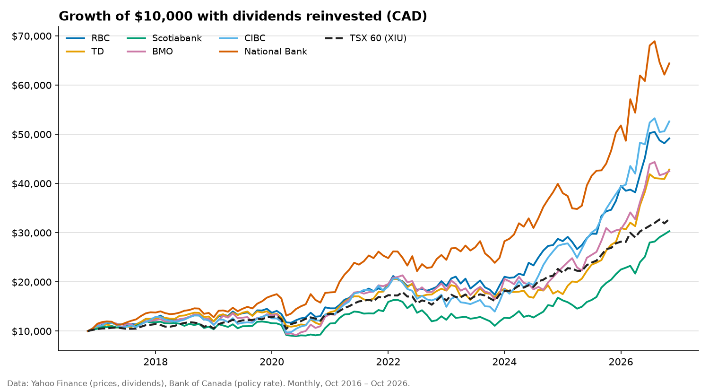

# Canada's Big Six banks: ten years of shareholder returns

How much did Canada's six largest banks actually return to shareholders over the last ten years,
how much of that came from dividends, and how did they behave when the Bank of Canada raised
and cut rates? This project answers those questions from public data and writes the answers up
as a [report](report/REPORT.md) with tables and charts.

**This is historical analysis, not investment advice.** Past returns don't predict future ones.

## Results

<!-- results:start -->
_Oct 2016 to Oct 2026, dividends reinvested. Full report: [report/REPORT.md](report/REPORT.md)._

- **$10,000 in the Big Six grew to $47,459** (Oct 2016 to Oct 2026, dividends reinvested, equal weight). That's 16.9% a year, 4.2 percentage points a year more than the TSX 60 (XIU), which turned $10,000 into $32,768.
- **National Bank returned the most and Scotiabank the least**: 20.5% vs 11.7% a year. Over 10 years that gap is the difference between $64,409 and $30,305.
- **Dividends added to returns.** For the average bank, share prices rose 11.6% a year and dividends added another 4.9%, about 30% of the total.
- **None of the six cut its dividend per share** at any point in the period. Dividend growth ranged from 4.5% a year (Scotiabank) to 9.2% (National Bank).


<!-- results:end -->

## Questions it answers

| Question | Measure |
|---|---|
| What did $10,000 become? | Total return with dividends reinvested, per year and in dollars |
| How much came from dividends? | Total return minus share-price return |
| How bumpy was the ride? | Volatility, worst fall from a previous high, months to recover |
| How closely do banks follow the market? | Beta against the TSX 60 (XIU) |
| Did anyone cut their dividend? | Every payment compared with the one before it |
| How did banks do while rates went up, or down? | Returns over each rate cycle, found from Bank of Canada data |

The six banks are RBC, TD, Scotiabank, BMO, CIBC and National Bank. The benchmark is XIU, an
ETF that tracks the S&P/TSX 60, so it's something an investor could actually have bought instead.

## Run it

Needs Python 3.11 or newer.

```bash
python -m venv .venv && source .venv/bin/activate
pip install -e '.[dev]'
python -m bankstocks            # downloads data, writes report/ and updates the results above
python -m bankstocks --refresh  # download again instead of using the cache in data/raw/
python -m bankstocks --end 2025-12 --years 5
pytest                          # tests use made-up data and don't need the internet
```

## How it works

```
src/bankstocks/
  universe.py   which banks, which benchmark, which rate series
  sources.py    download, cache and check the raw data
  metrics.py    returns, volatility, beta, drawdowns, dividends, rate cycles
  report.py     findings, tables and the Markdown report
  charts.py     the four charts
docs/WALKTHROUGH.md   plain-language explanation of every measure and design choice
```

- **Every sentence in the findings is calculated.** The report states which bank returned the
  most, whether anyone cut a dividend, and how banks did in each rate cycle by computing it,
  so re-running on newer data can't leave a stale claim behind.
- **Bad data fails loudly.** A missing month, a price in the wrong currency or an error
  response stops the run with a message rather than leaving a gap in the numbers.
- **The numbers are cross-checked.** The total return is calculated from closing prices and
  dividends, then compared with the return implied by Yahoo's own dividend-adjusted price.
  The report shows the gap for every security.

## Data

| Data | Source | Notes |
|---|---|---|
| Month-end prices and dividends (CAD) | Yahoo Finance public chart data | Unofficial; no key needed. Raw responses are cached in `data/raw/` and not committed. |
| Policy interest rate | [Bank of Canada Valet API](https://www.bankofcanada.ca/valet/docs), series V39079 | Official; no key needed. |

## Limitations

- **Survivorship:** these are the six largest banks today, which flatters a look backwards.
- **Monthly data** smooths over falls that happened within a month.
- **No taxes, fees or trading costs** for the banks. XIU's returns are after its fee.
- **Dividends** are counted in their ex-dividend month and reinvested at that month's close.

## How this was built

AI-assisted: the code, tests and write-up were produced with Claude Code, then reviewed. The
commits say so with a `Co-Authored-By` line.

## Licence

MIT
