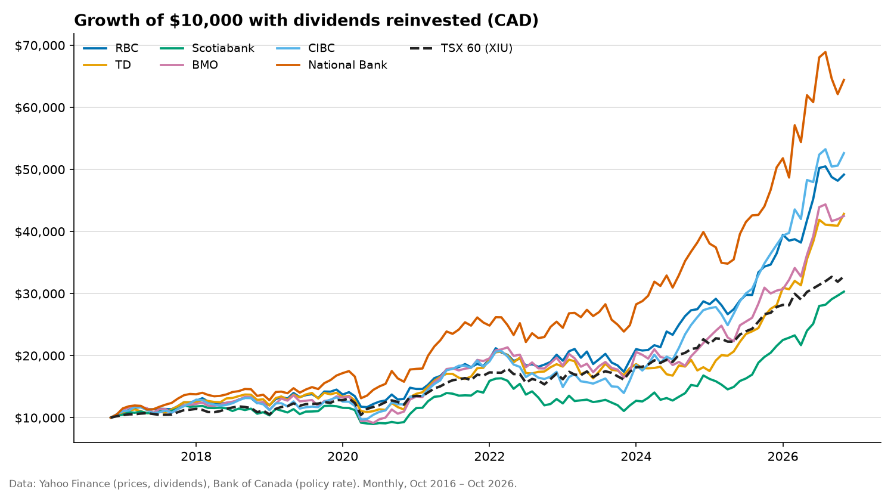
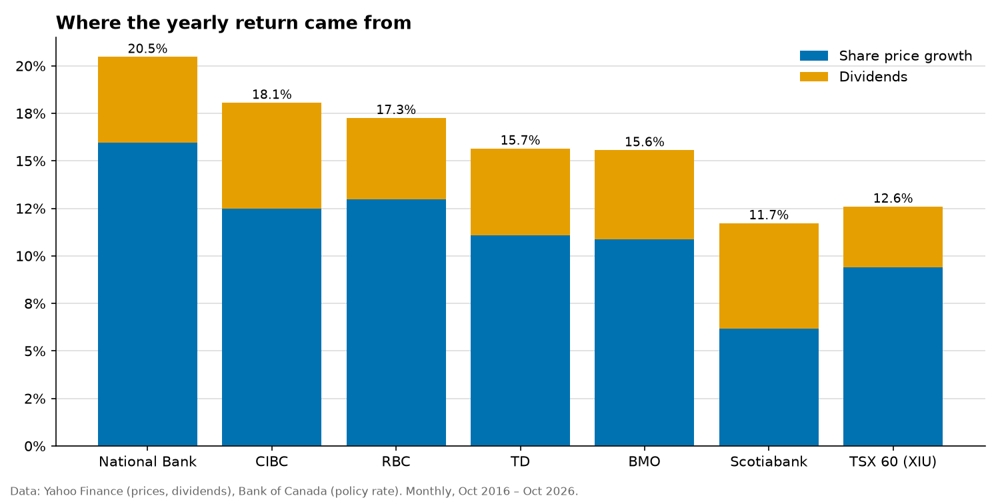
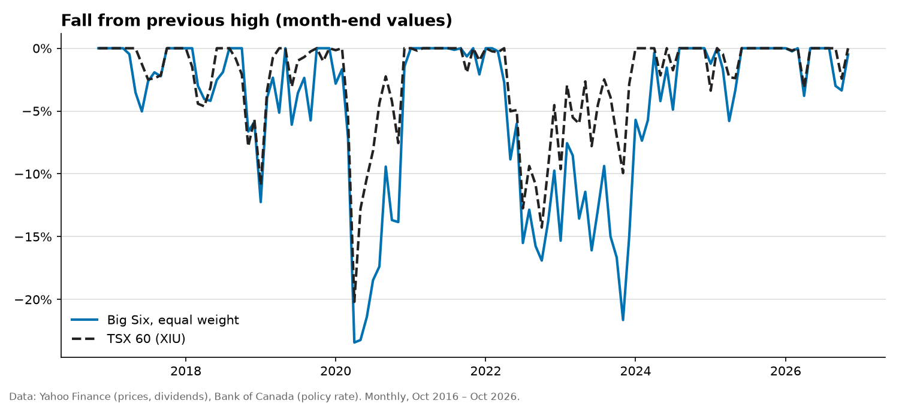
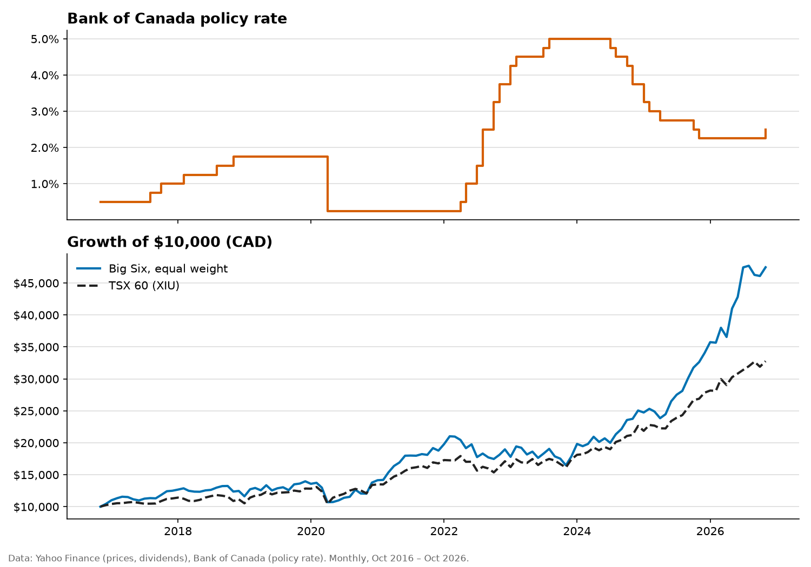

# Canada's Big Six banks: 10 years of shareholder returns

Oct 2016 to Oct 2026 (120 monthly returns), in Canadian dollars. Generated
Nov 3, 2026 by `python -m bankstocks`. **This is historical analysis, not investment
advice.** Past returns don't predict future ones.

## Key findings

- **$10,000 in the Big Six grew to $47,459** (Oct 2016 to Oct 2026, dividends reinvested, equal weight). That's 16.9% a year, 4.2 percentage points a year more than the TSX 60 (XIU), which turned $10,000 into $32,768.
- **National Bank returned the most and Scotiabank the least**: 20.5% vs 11.7% a year. Over 10 years that gap is the difference between $64,409 and $30,305.
- **Dividends added to returns.** For the average bank, share prices rose 11.6% a year and dividends added another 4.9%, about 30% of the total.
- **None of the six cut its dividend per share** at any point in the period. Dividend growth ranged from 4.5% a year (Scotiabank) to 9.2% (National Bank).
- **The worst stretch for the group was a 23% fall** from Nov 2019 to Mar 2020 (month-end values), recovered by Dec 2020. The TSX 60's worst was 20% (Jan 2020 to Mar 2020).
- **Bank shares moved roughly in line with the market**: the group's beta against the TSX 60 was 1.09, ranging from 0.94 (RBC) to 1.24 (BMO). Volatility was 17% a year for the group vs 13% for the TSX 60.
- **While the Bank of Canada raised rates from 0.50% to 1.75%** (Jul 2017 to Oct 2018), the Big Six returned +9.9% and beat the TSX 60 (+4.1%).
- **While the Bank of Canada cut rates from 1.75% to 0.25%** (Mar 2020), the Big Six returned -17.6% and trailed the TSX 60 (-15.6%).
- **While the Bank of Canada raised rates from 0.25% to 5.00%** (Mar 2022 to Jul 2023), the Big Six returned -9.2% and trailed the TSX 60 (+1.4%).
- **While the Bank of Canada cut rates from 5.00% to 2.25%** (Jun 2024 to Oct 2025), the Big Six returned +57.6% and beat the TSX 60 (+39.2%).

## Growth of $10,000

## Returns and risk

| | Total return / yr | From price | From dividends | $10,000 became | Volatility | Beta | Worst fall | Back to peak |
|---|---|---|---|---|---|---|---|---|
| National Bank | 20.5% | 16.0% | 4.5% | $64,409 | 20% | 1.17 | -25% (Jan 2020 → Mar 2020) | Aug 2020 |
| CIBC | 18.1% | 12.5% | 5.6% | $52,616 | 20% | 1.16 | -33% (Feb 2022 → Oct 2023) | Jul 2024 |
| RBC | 17.3% | 13.0% | 4.3% | $49,157 | 16% | 0.94 | -19% (Nov 2019 → Apr 2020) | Nov 2020 |
| TD | 15.7% | 11.1% | 4.6% | $42,828 | 18% | 0.95 | -22% (Nov 2019 → Apr 2020) | Jan 2021 |
| BMO | 15.6% | 10.9% | 4.7% | $42,497 | 21% | 1.24 | -33% (Apr 2019 → May 2020) | Feb 2021 |
| Scotiabank | 11.7% | 6.2% | 5.6% | $30,305 | 18% | 1.07 | -32% (Feb 2022 → Oct 2023) | Nov 2024 |
| **Big Six, equal weight** | 16.9% | 12.0% | 4.9% | $47,459 | 17% | 1.09 | -23% (Nov 2019 → Mar 2020) | Dec 2020 |
| **TSX 60 (XIU)** | 12.6% | 9.4% | 3.2% | $32,768 | 13% | 1.00 | -20% (Jan 2020 → Mar 2020) | Nov 2020 |

- **Total return** includes dividends, reinvested at the month-end close. **From price** and
  **from dividends** split it into share-price growth and the extra return from dividends.
- **Volatility** is the annualised standard deviation of monthly returns.
- **Beta** measures how much a stock moved, on average, for each 1% move in the TSX 60.
- **Worst fall** and **back to peak** use month-end values, so falls within a month look smaller.

## Dividends

| | Yield (last 12 months) | Dividend growth / yr | Cuts |
|---|---|---|---|
| Scotiabank | 3.4% | 4.5% | none |
| BMO | 2.8% | 7.1% | none |
| CIBC | 2.6% | 5.8% | none |
| TD | 2.5% | 7.4% | none |
| National Bank | 2.4% | 9.2% | none |
| RBC | 2.4% | 7.8% | none |

Dividend growth compares the first and last payment per share in the period. A **cut** is any
payment smaller than the one before it.

## Interest-rate cycles

Cycles are found from the data: consecutive policy-rate moves in the same direction that add
up to at least 0.5 percentage points. Returns run from the end of the month before
the first move to the end of the month of the last one.

| Cycle | Policy rate | Months | Big Six | TSX 60 |
|---|---|---|---|---|
| Hiking, Jul 2017 – Oct 2018 | 0.50% → 1.75% | 16 | +9.9% | +4.1% |
| Cutting, Mar 2020 | 1.75% → 0.25% | 1 | -17.6% | -15.6% |
| Hiking, Mar 2022 – Jul 2023 | 0.25% → 5.00% | 17 | -9.2% | +1.4% |
| Cutting, Jun 2024 – Oct 2025 | 5.00% → 2.25% | 17 | +57.6% | +39.2% |

## Data check

As a cross-check, our compounded total return is compared with the return implied by Yahoo's own
dividend-adjusted close. Small gaps are expected: Yahoo reinvests dividends on the ex-date, this
analysis at the month end. Gaps over 0.5 points a year are flagged ⚠.

| | Our total return / yr | Yahoo adjusted close / yr | Gap |
|---|---|---|---|
| RBC | 17.26% | 17.26% | -0.00 pts |
| TD | 15.66% | 15.71% | +0.06 pts |
| Scotiabank | 11.73% | 11.76% | +0.04 pts |
| BMO | 15.57% | 15.54% | -0.03 pts |
| CIBC | 18.06% | 18.06% | -0.00 pts |
| National Bank | 20.47% | 20.50% | +0.02 pts |
| TSX 60 (XIU) | 12.60% | 12.60% | +0.00 pts |

## Method and limitations

- **Survivorship:** these are the six largest banks *today*. Picking today's winners and looking
  back flatters past returns.
- **Monthly data:** returns, volatility and falls are measured month end to month end.
- **No taxes, fees or trading costs** for the banks. XIU's returns are after its management fee.
- **Dividends** are counted in the month of their ex-dividend date and reinvested at that
  month's close.
- **Equal weight** means the six banks are held in equal amounts, rebalanced every month.
- **Data:** prices and dividends from Yahoo Finance's public chart data, which is unofficial and
  can contain errors (see the data check). Policy rate from the Bank of Canada's Valet API,
  series V39079, taken at month end.
